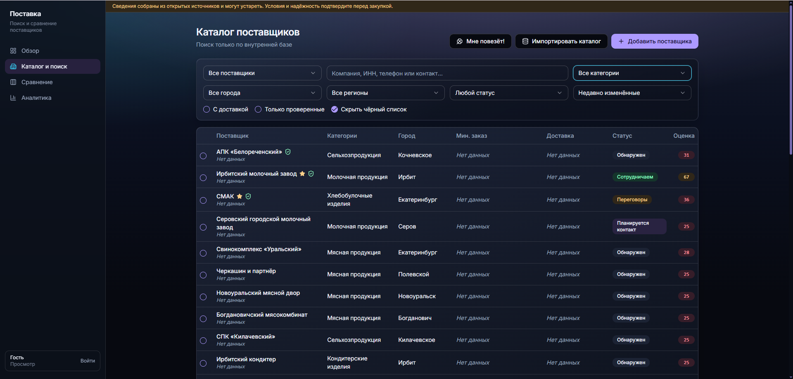
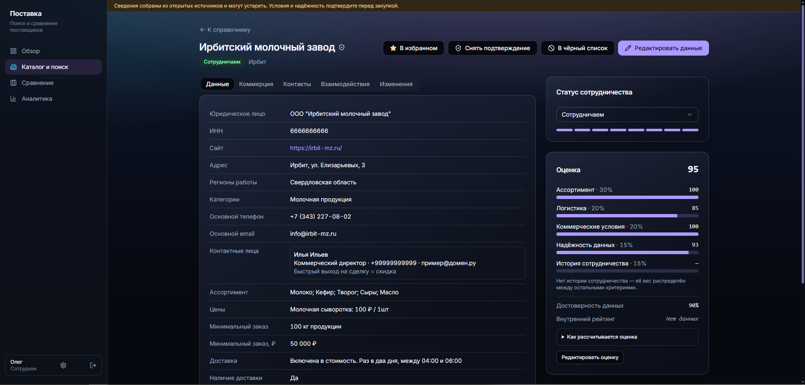
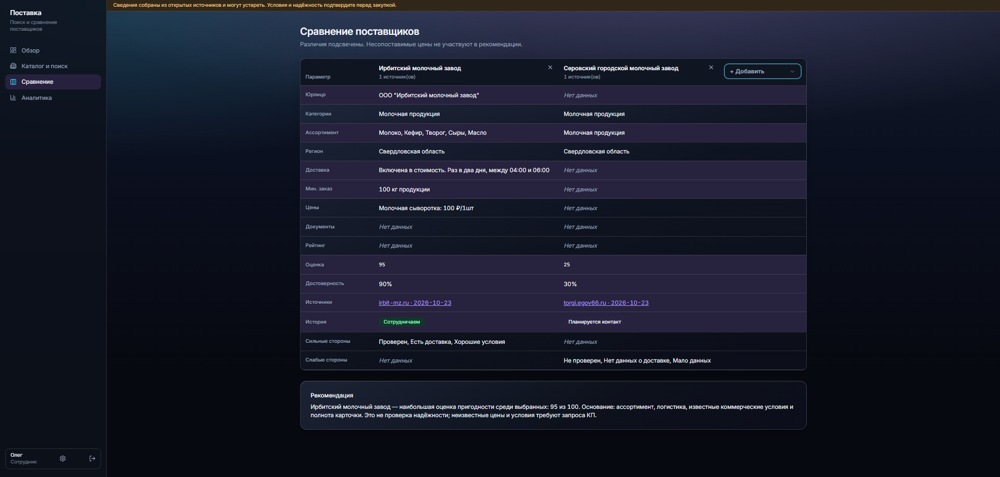
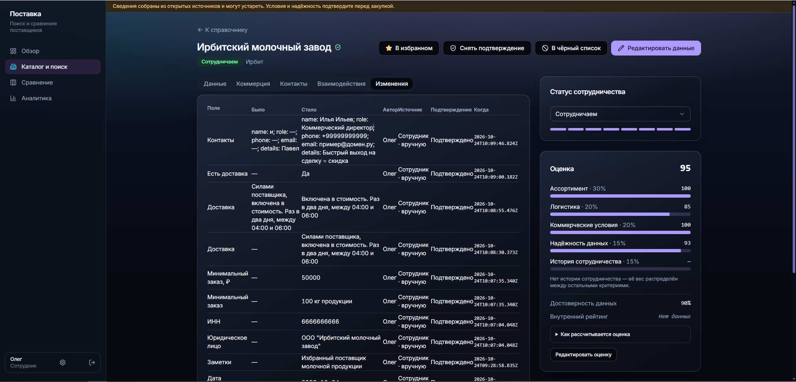
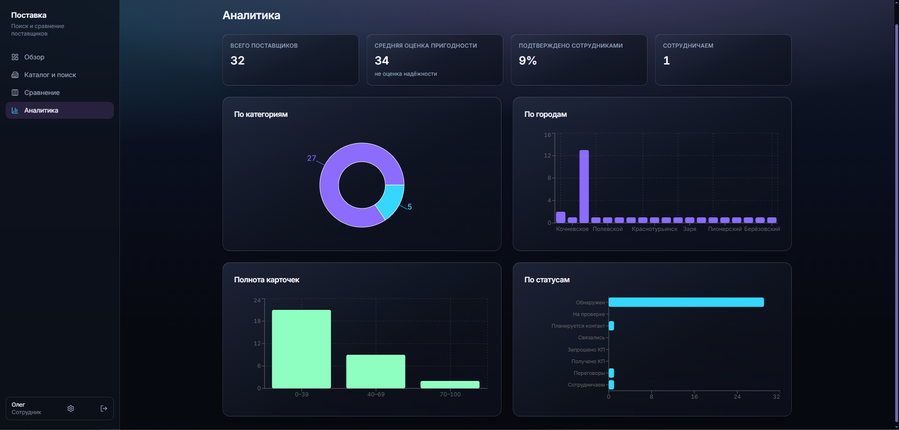

# Поставка

**Поставка — сервис поиска и сравнения поставщиков.** Это функциональный прототип рабочего места закупщика для food-направления: от списка возможных компаний до решения, кому звонить и у кого запрашивать коммерческое предложение.

**Посмотреть:** [демо-стенд](https://demonstration.alwaysdata.net/) открыт без регистрации. **Оценить задание без автора:** [руководство для проверяющих](docs/product/REVIEWER_GUIDE.md) сопоставляет работающие сценарии с исходным ТЗ и прямо называет ограничения. [Дорожная карта](ROADMAP.md) объясняет, что появится после прототипа. Репозиторий на 24.10.2026 приватный: для независимой оценки кода нужен доступ к нему или отдельное решение владельца о публикации.

## Какую работу берёт на себя сервис

Представим закупщика, которому нужна упаковка с доставкой в Екатеринбург. Обычный поиск выдаёт сайты и каталоги, но не отвечает, кто действительно работает в регионе, какой объём заказа допустим, когда проверяли телефон и что уже обсуждал коллега. «Поставка» помогает пройти эту цепочку без потери контекста:

1. **Собрать круг кандидатов.** Каталог фильтруется по категории, городу и региону; можно искать по товару, названию, телефону и контактному лицу. Компания, которой нет в открытых источниках, добавляется вручную. На стенде уже сохранены 32 реальные организации с источниками.
2. **Понять, чего ещё не хватает для решения.** Карточка разделяет сведения о компании, коммерческие условия и людей, с которыми ведётся работа. Неизвестная цена остаётся неизвестной: это повод запросить КП, а не основание считать предложение выгодным.
3. **Проверить и сохранить результат общения.** Сотрудник записывает условия, дату актуальности, контакт и исход разговора. Статусы показывают, дошла ли компания до запроса и получения КП, переговоров или сотрудничества. История позволяет другому сотруднику продолжить работу без повторного поиска и звонков.
4. **Сравнить кандидатов до контакта или закупки.** Таблица сопоставляет 2–4 компании, показывает различия и пробелы, а объяснимый рейтинг помогает расставить приоритет. Несопоставимые товары и единицы измерения не превращаются в ложный вывод «этот поставщик дешевле».
5. **Передать контекст дальше.** Аналитика показывает состояние базы, а REST API даёт основу для обмена с другими системами. Готового коннектора для конкретной CRM или 1С проект не заявляет.

Поиск сейчас работает **по сохранённой базе**, а не по интернету в момент запроса. Начальные 32 карточки собраны из открытых источников: 11 — по страницам компаний, остальные — по [региональному перечню товаропроизводителей](https://torgi.egov66.ru/site/Menu/Page/526). Будущий веб-поиск найдёт лишь тех, кто оставил доступный цифровой след. Многие поставщики не публикуют цену, минимальный заказ или актуальные контакты; эти сведения должен подтвердить человек по звонку, переписке, КП либо официальному ответу. Поэтому источники и даты важнее видимости «полной» анкеты. Подтверждённое сотрудником поле не должно безусловно затираться новым результатом извлечения.

Прототип не выдаёт рейтинг за независимую проверку надёжности. Живой интернет-поиск и внешняя LLM пока не подключены; подбор «Мне повезёт!» работает как объяснимый алгоритм по существующей базе. Файлы КП, договоров и сертификатов на бесплатном демо не загружаются — сохраняются только текстовые сведения о документах. Отдельные учётные записи и роли также относятся к следующему этапу. Эти границы и бизнес-причины решений подробнее разобраны в [материалах для защиты](docs/product/DEFENSE_BRIEF.md).

## Скриншоты

Эти экраны показывают путь закупщика: найти кандидатов, изучить сведения, сравнить предложения и сохранить результат работы для коллеги.

| Экран | Что помогает оценить |
| --- | --- |
|  | **Поиск поставщиков.** Категория и регион сужают список до компаний, подходящих под конкретную закупку. |
|  | **Проверка информации.** В карточке видны сведения о компании, их источники и пробелы, которые ещё нужно уточнить. |
|  | **Выбор кандидата для контакта.** Сопоставление условий помогает понять, кому звонить первым и какие вопросы задать. |
|  | **Сохранение знаний команды.** Проверенные условия и история изменений позволяют коллеге продолжить работу без повторных звонков. |
|  | **Контроль качества базы.** Аналитика показывает, сколько карточек заполнено и где не хватает сведений. |

Изображения находятся в [`docs/screenshots/`](docs/screenshots/README.md). Для публичных кадров используйте только демонстрационные сведения: не показывайте пароли, внутренние комментарии, личные контакты и конфиденциальные коммерческие условия.

## Разработка, которую можно подхватить

Проект организован так, чтобы другой инженер или AI-агент мог продолжить работу без доступа к этому чату и к компьютеру автора. Репозиторий хранит [правила работы](AGENTS.md), [проверенное состояние и версию стенда](PROJECT_STATE.md), [следующие задачи с критериями проверки](TASKS.md), [архитектуру](docs/architecture/README.md) и [дорожную карту](ROADMAP.md). Новый исполнитель сначала сверяет эти записи с `main`, CI и опубликованным демо, затем берёт ограниченную задачу, фиксирует результат в PR и обновляет контрольную точку. Тесты и запись проверок позволяют передать не обещание, а воспроизводимый результат. Продуктовые решения, доступы и публикация остаются за владельцем; автономность здесь означает непрерывность разработки с человеческим контролем.

Этот подход важен для роли AI-инженера: ценность не в количестве запущенных агентов, а в том, что работа делится на проверяемые шаги, сохраняет контекст, не требует повторного исследования и может быть безопасно принята следующим исполнителем.

Для краткого самостоятельного обзора используйте [руководство для проверяющих](docs/product/REVIEWER_GUIDE.md); для живого показа — [сценарий](docs/product/DEMO_SCRIPT.md). [Черновик письма HR](docs/product/HR_SUBMISSION.md) не является частью работающего продукта и не отправлен автоматически.

## Локальный запуск

Нужны Node.js 24 и pnpm. В PowerShell задайте секреты только для локального процесса:

```powershell
$editorSecret = Read-Host 'Пароль редактора' -AsSecureString
$env:POSTAVKA_EDITOR_PASSWORD = [pscredential]::new('local', $editorSecret).GetNetworkCredential().Password
$env:POSTAVKA_SESSION_SECRET = [guid]::NewGuid().ToString('N') + [guid]::NewGuid().ToString('N')
$env:POSTAVKA_DB_PATH = './data/postavka.sqlite'
pnpm install --frozen-lockfile
pnpm dev
```

Адрес разработки: `http://127.0.0.1:5173/`. Для изменения карточек откройте `/auth` и войдите с паролем редактора. Без заданных серверных секретов просмотр работает, запись отключена. Не кладите реальные пароли в Git.

## Проверка

```powershell
pnpm typecheck
pnpm test
pnpm build
$env:PORT = '4173'
pnpm start
```

Production-сборка использует Vite, TanStack Start и Nitro с серверным Node.js runtime. Адрес preview: `http://127.0.0.1:4173/`.

## Структура

- `src/routes/` — страницы и маршруты.
- `src/components/` — элементы интерфейса.
- `src/lib/catalog.ts` — воспроизводимый перечень компаний и источников.
- `src/lib/fixtures.ts` — типы и статусы; старые демо-объекты больше не загружаются в новую базу.
- `src/lib/store.server.ts` — SQLite и журнал изменений.
- `src/lib/api.server.ts` — REST API, авторизация сотрудника и интеграции.
- `src/lib/scoring.ts` — пересчёт рейтинга после редактирования.
- `src/styles.css` — токены и оформление.

Поиск фильтрует сохранённый каталог, включая название, ассортимент, регион, телефон и контактных лиц. Сравнение читает те же карточки из БД; подбор «Мне повезёт!» учитывает запрос и исключает чёрный список и действующих партнёров. Оценка пригодности пересчитывается детерминированно после изменения карточки и не служит независимой оценкой надёжности компании. Подтверждённые сотрудником поля защищены от обновлений интеграции: новые значения попадают в предложения, которые можно принять или отклонить в карточке. Цены компаний без одинаковых единиц и товаров не ранжируются. Опубликованный бесплатный стенд указан в `PROJECT_STATE.md`; доступность и точную версию проверяйте перед демонстрацией.

Поле «Документы» в карточке хранит только текстовые сведения. **Загрузки файлов КП, соглашений и других документов в прототипе и на демо-стенде нет.** Файловый контур включён в [план развития до MVP](ROADMAP.md), а затем в требования к первой коммерческой версии. Живой интернет-поиск и внешняя LLM пока не подключены; AI не следует демонстрировать как выполненный сценарий.

Если база создана на предыдущем этапе, авторизованный сотрудник может выполнить `POST /api/catalog/import`. Повторный вызов не создаёт дубликаты по ID, домену сайта и ИНН и не перезаписывает существующие карточки. Старые демонстрационные записи в существующей базе автоматически не удаляются, чтобы не потерять ручные правки; для чистой демонстрации используйте новый SQLite-файл.

## REST API

`GET /api/suppliers?limit=50&offset=0&updated_after=<ISO-дата>` возвращает карточки с пагинацией. `GET /api/suppliers/{id}` получает карточку. Для создания и изменения используются `POST /api/suppliers` и `PATCH /api/suppliers/{id}`. Для истории доступны `/changes`, `/interactions` и `/proposals`; история требует авторизации. Запись требует cookie сотрудника или отдельного `Authorization: Bearer <POSTAVKA_INTEGRATION_TOKEN>`. Токен интеграции задаётся только на сервере. Анонимные ответы скрывают внутренние заметки, контактных лиц и цены. Описание интерфейса находится в `public/openapi.yaml` (в работающем приложении — `/openapi.yaml`).

SQLite-файл необходимо разместить на постоянном диске: на хостинге с эфемерной файловой системой записи не переживут перезапуск. Бесплатная личная демонстрация развёрнута на alwaysdata; [порядок обновления](deploy/alwaysdata/README.md) требует сохранить БД отдельно и проверить её после перезапуска. Наблюдались задержки ответов хостинга, поэтому публичное демо не означает коммерческое SLA. Совместимость с конкретной конфигурацией 1С не заявляется.

Интерфейс сделан на основе существующего кода проекта. История Git сохранена. Используемые сторонние пакеты сохраняют собственные лицензионные условия; проектная лицензия пока не выбрана владельцем.

